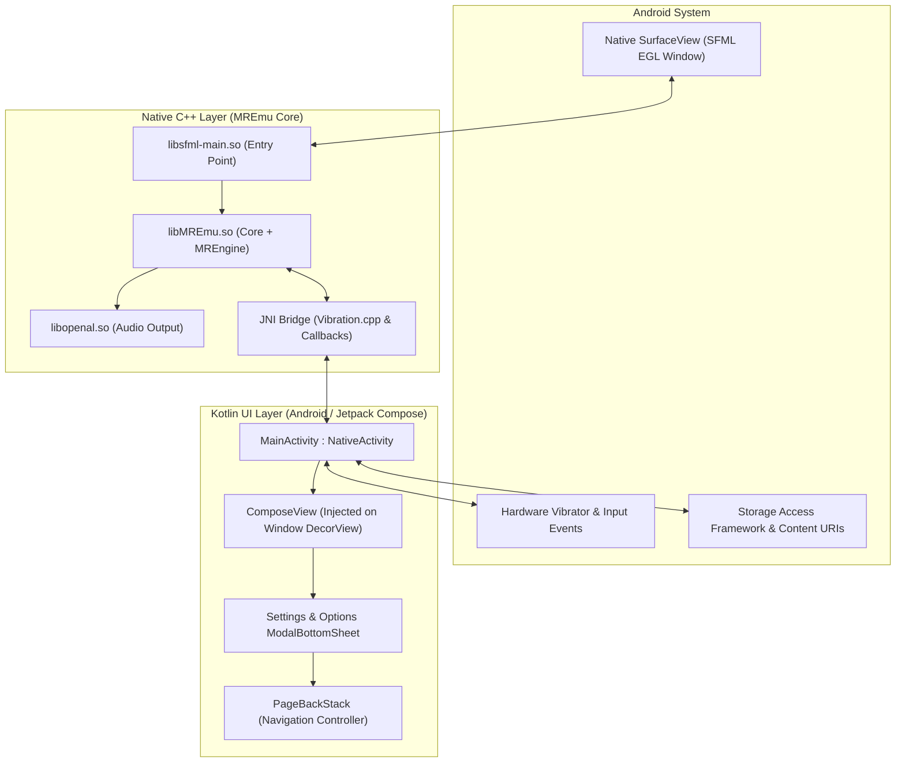

# Android Frontend & Architecture

This document describes the Android port of **MREmu**, covering its hybrid NativeActivity/Jetpack Compose architecture, JNI bridges, storage model, and build system.

---

## 1. Android Architecture Overview

MREmu on Android combines the native high-performance C++ emulation core with modern Android Jetpack Compose UI:



---

## 2. Hybrid NativeActivity + Jetpack Compose

Unlike standard Android applications that run entirely in the JVM, MREmu uses a specialized hybrid model:

### `MainActivity : NativeActivity`

1. **Surface Ownership**: `NativeActivity` handles the creation and destruction of the native EGL drawing surface rendered by SFML.
2. **Lifecycle Interfaces**: `MainActivity.kt` manually implements:
   - `LifecycleOwner` (via `LifecycleRegistry`)
   - `ViewModelStoreOwner` (via `ViewModelStore`)
   - `SavedStateRegistryOwner` (via `SavedStateRegistryController`)
3. **DecorView Overlay**: A Jetpack Compose `ComposeView` is attached directly to the window's `DecorView`. This allows rich modern Material 3 dialogs, animations, and settings menus to float directly over the hardware-rendered SFML emulator surface.

---

## 3. JNI Bridge Subsystem

The native C++ core communicates with the Kotlin activity via targeted JNI functions:

### 1. Options Dialog Trigger

- When the user taps the on-screen **Options** button (rendered below the keyboard in SFML), C++ invokes `request_options_dialog()` in [`MREmu.cpp`](../MREmu/MREmu.cpp).
- This attaches to the JVM, calls `MainActivity.showOptionsDialogUi()`, and presents the Compose bottom sheet.

### 2. Storage Permission Synchronization

- `MainActivity.notifyPermissionState(boolean granted)` signals the C++ rendering thread when storage access is ready so it can initialize `/sdcard/MREmu/fs/`.

### 3. Haptic Feedback (Vibration)

- Keypad presses trigger `Vibration::vibrate()` in [`MREmu/jni/Vibration.cpp`](../MREmu/jni/Vibration.cpp).
- The JNI call invokes `MainActivity.vibrate(int ms)`, which delegates to `VibratorManager` (Android 12+) or `Vibrator` (`VibrationEffect.createOneShot`).

---

## 4. Storage & File Access (SAF)

Modern Android versions enforce strict Scoped Storage policies:

- **Storage Base**: MREmu maps virtual drives under `/sdcard/MREmu/fs/` (`fs/c`, `fs/d`, `fs/e`, `fs/e/mre`).
- **All Files Access**: Requests `MANAGE_EXTERNAL_STORAGE` on Android 11+ (API 30+) to allow reading arbitrary VXP directories.
- **Storage Access Framework (SAF)**: Includes a system document picker allowing users to browse and import `.vxp` packages from any internal or cloud location.
- **Intent Filter**: `MainActivity` registers an `ACTION_VIEW` intent filter for `content://` and `file://` URIs matching `.*\.vxp`, allowing file managers (Total Commander, ZArchiver, etc.) to launch VXP files directly into MREmu.

### In-App VXP Library & Management

Accessible from the **Options** bottom sheet under the **Files** section:

- **Index Sources**: Scans the default guest folder (`/sdcard/MREmu/fs/e/mre/`) and tracks recently launched external/SAF files via persistent `SharedPreferences`.
- **Search & Sort**: Real-time substring search by filename, with sorting by Name, Date modified, or File size (ascending / descending toggle).
- **Recents Filter**: Quick filter chips to toggle between All files and Recent files.
- **File Operations**:
  - **Launch**: Runs the VXP directly on a background thread via JNI `nativeLoadVxpFile`.
  - **Rename**: Renames `.vxp` files in-place with duplicate collision protection.
  - **Share / Export**: Exports `.vxp` packages to external apps using `FileProvider` (`androidx.core.content.FileProvider`).
  - **Delete**: Deletes `.vxp` files with a confirmation dialog.
  - **Open Containing Folder**: Opens the parent folder in the system file manager.

---

## 5. Build System & Multi-ABI Support

The Android project is located under [`Android/`](../Android):

- **Gradle Module**: Single `:app` module.
- **External Native Build**: `Android/app/build.gradle` directly points `externalNativeBuild.cmake.path` to the root [`CMakeLists.txt`](../CMakeLists.txt).

### ABI Configuration (`mremuAbis`)

To optimize compilation times, MREmu builds only a single architecture by default:

- **Default ABI**: `arm64-v8a` (modern 64-bit ARM).
- **Supported ABIs**: `arm64-v8a`, `armeabi-v7a` (32-bit ARM), `x86_64` (emulators/Chromebooks).

You can customize the target ABIs via the `mremuAbis` Gradle property:

```bash
./gradlew :app:assembleDebug -PmremuAbis=arm64-v8a,armeabi-v7a
```

### Fast Edit Verification

To quickly check Kotlin code edits without triggering a full native build:

```bash
./gradlew :app:compileDebugKotlin -q
```
