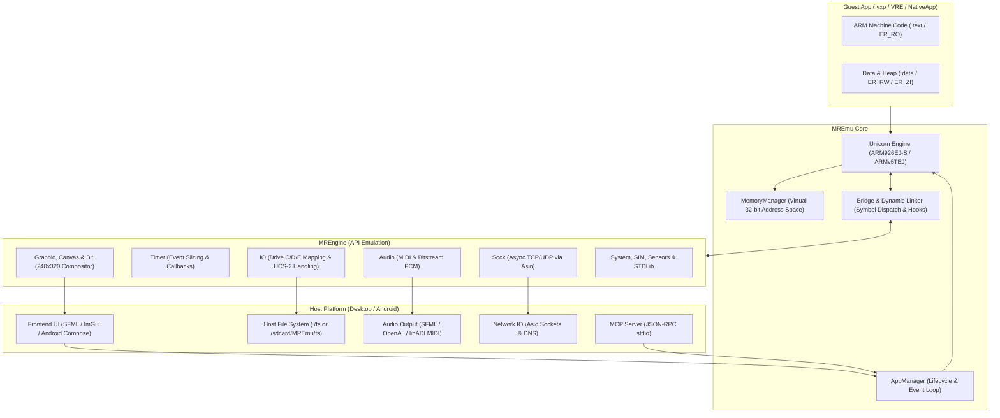
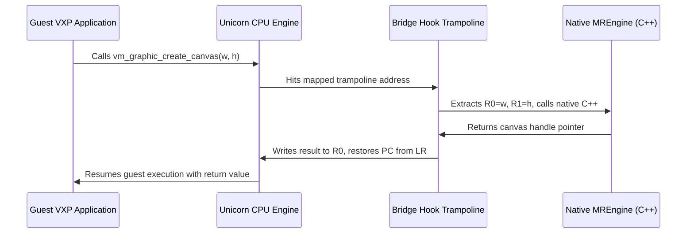
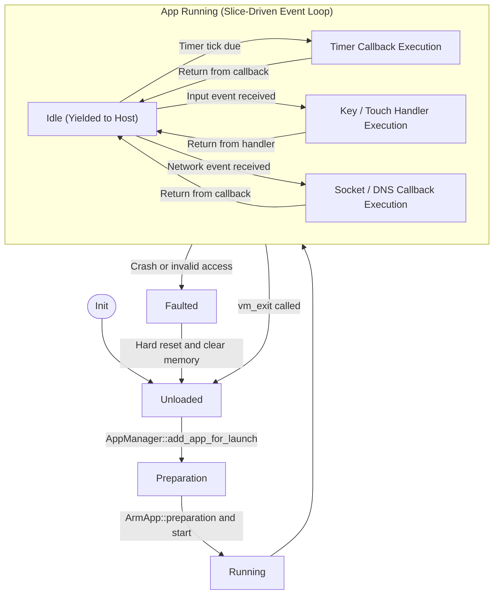

# MREmu System Architecture

This document details the core architectural design of **MREmu**, explaining how the emulator virtualizes an ARM-based MediaTek feature phone environment on modern host systems.

---

## 1. High-Level Architecture Overview

MREmu is structured around a central emulation core coupled with modular subsystem engines and frontends. Emulated ARM binaries execute inside a virtualized memory address space powered by the **Unicorn** CPU engine. Whenever an emulated program calls a MediaTek MRE API (such as allocating memory, drawing to a canvas, or opening a socket), execution traps into the C++ **Bridge** subsystem, which translates guest arguments and invokes native C++ handler implementations.



---

## 2. CPU Emulation Engine (Unicorn)

MREmu utilizes the **Unicorn Engine** (a lightweight QEMU-based CPU emulator) configured for the **ARMv5TEJ** architecture (specifically emulating ARM926EJ-S class processors typical of MediaTek MT6250, MT6260, and MT6261 series SoCs).

### CPU Modes & Registers

- **Architectures**: ARM (32-bit fixed-length instructions) and Thumb (16-bit instructions) modes are seamlessly interworked.
- **Registers**: Full register set `R0` through `R12`, `SP` (`R13`), `LR` (`R14`), `PC` (`R15`), and `CPSR`.
- **Calling Convention**: Complies with the standard **AAPCS** (ARM Architecture Procedure Call Standard):
  - Parameters 1–4 are passed in `R0`–`R3`.
  - Additional parameters are passed on the stack pointed to by `SP`.
  - Return values are delivered in `R0` (or `R0`+`R1` for 64-bit values).

### Execution Slicing & Stepping

Unlike desktop CPU emulators that run a free-running thread continuously, MREmu uses a **slice-driven execution model**:

1. An execution slice begins when an event occurs (e.g., timer expiration, key press, touch event, or network packet).
2. The core enters [`Bridge::run_cpu`](../MREmu/Bridge.cpp) via `uc_emu_start`.
3. Execution proceeds until the app returns to its idle handler (`idle_p`), completes its callback, or exhausts a designated instruction budget.
4. When stepped externally (via the MCP tool `emu_step`), bounded slices are clamped to at most **4096 instructions** per invocation to prevent unbounded loops from locking the host thread.

---

## 3. Virtual Memory & Address Space

The emulator models a unified 32-bit virtual memory address space.

### Memory Pools & Layout

Memory is allocated from a contiguous shared block allocated on the host via `_aligned_malloc` with 16 MB alignment:

```text
0x00000000 +------------------------------------------+ (Virtual Base)
           | Reserved / System Vectors                |
0x00008000 +------------------------------------------+ (ADS Binary Base)
           | Application Code (ER_RO / .text)         |
           | Read-Write Data (ER_RW / .data)          |
           | Zero-Init BSS (ER_ZI / .bss)             |
           | ADS Application Heap                     |
           | ADS Application Stack (3 KB default)     |
           +------------------------------------------+
           | Dynamic App Allocations (vm_malloc)      |
           +------------------------------------------+
0x02000000 +------------------------------------------+ (32 MB Boundary)
```

### Pointer Virtualization (`ADDRESS_TO_EMU` / `ADDRESS_FROM_EMU`)

To support 64-bit host systems without pointer truncation bugs, MREmu computes virtual addresses via fixed offsets:

```cpp
// Conversion from host pointer to virtual 32-bit guest pointer
uint32_t ADDRESS_TO_EMU(void* x) {
    if (x == nullptr) return 0;
    return (uint32_t)((uint64_t)x - shared_memory_offset);
}

// Conversion from virtual guest pointer to host addressable pointer
void* ADDRESS_FROM_EMU(uint32_t x) {
    if (x == 0) return nullptr;
    return (void*)(x + shared_memory_offset);
}
```

The [`Memory::MemoryManager`](../MREmu/Memory.h) class handles dynamic allocations within the virtual memory pool, keeping track of allocated and free regions with 8-byte alignment guarantees.

---

## 4. Bridge & Dynamic Linker Subsystem

MRE applications do not link against shared libraries (`.so`) with traditional symbol resolution. Instead, every API call is resolved at runtime through a single exported entry point: `vm_get_sym_entry(const char* symbol)`.

### Dynamic Dispatch Table

1. When a VXP application starts, it is passed the address of `vm_get_sym_entry`.
2. The app queries `vm_get_sym_entry("vm_graphic_create_canvas")`, which returns a virtual address corresponding to that API function.
3. In MREmu, [`Bridge::init()`](../MREmu/Bridge.cpp) constructs a function vector (`func_map`) of all supported MRE APIs.
4. For each API, a small trampoline containing a `BX LR` or breakpoint instruction is mapped in a reserved trampoline buffer.
5. A Unicorn hook (`UC_HOOK_CODE` installed on the trampoline region) intercepts execution when the guest CPU executes the trampoline.
6. The hook unpacks registers `R0`–`R3` (and stack parameters), executes the native C++ implementation, writes the return value back to `R0`, and redirects `PC` back to the guest caller via the saved Link Register (`LR`).



---

## 5. Application Launchers & Binary Loaders

MREmu supports two major executable structures via [`ArmApp.cpp`](../MREmu/ArmApp.cpp):

### 1. Standard ELF Loaders

- Standard ELF32 binaries compiled with GCC.
- ELF segments (`PT_LOAD`) are copied to virtual memory at specified virtual addresses.
- Relocation sections (`.rel.dyn` and `.rel.plt`) are parsed, applying `R_ARM_RELATIVE` (0x17) relocations by adding `offset_mem`.

### 2. ARM Developer Suite (ADS) Loaders

- Older commercial MRE applications were built using ARM Developer Suite 1.2 (ADS).
- These binaries have distinct scatter-loading regions:
  - `ER_RO`: Execution region for Read-Only code and constants.
  - `ER_RW`: Execution region for initialized Read-Write variables.
  - `ER_ZI`: Execution region for Zero-Initialized variables (BSS).
- Compressed ADS binaries (`is_zipped = true`) contain a trailer with `compress_ads_elf_info`, decompressing `ER_RO` and `ER_RW` via `miniz` (zlib).
- Initialized by calling [`Bridge::ads_start`](../MREmu/Bridge.cpp), setting up `R9` (static base), `R10` (stack limit), `SP` (stack pointer), and passing `vm_get_sym_entry` in `R0`.

---

## 6. Event Loop & Application Lifecycle

Applications in MREmu are strictly event-driven:



1. **Bootstrap**: The application registers handlers (`vm_pmng_register_msg_proc`, `vm_reg_keyboard_callback`, `vm_reg_pen_callback`).
2. **Idle State**: The app yields CPU to the emulator host.
3. **Timer Processing**: [`MREngine::Timer::update`](../MREmu/MREngine/Timer.cpp) inspects all active timer handles and invokes expired callbacks in the guest context.
4. **Input Processing**: Key and touch events are translated and dispatched to the registered pen/keyboard callback functions.
5. **Hard Reset & Recovery**: If an invalid memory access or crash occurs, [`trigger_hard_reset_with_error`](../MREmu/MREmu.cpp) halts CPU emulation, resets the memory manager, flushes temporary files, and restarts the built-in `AppSelector` launcher.
