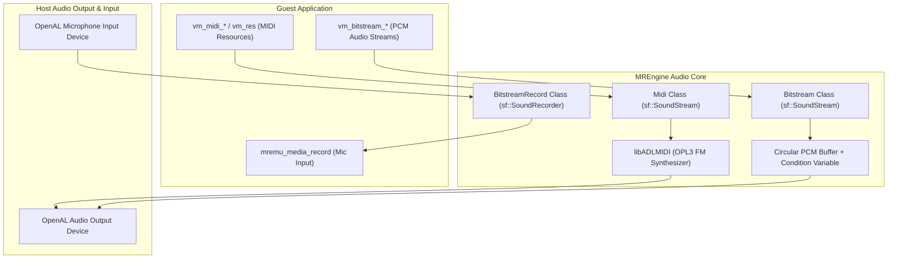

# Audio Subsystem

This document describes the audio playback and recording architecture of **MREmu**, including MIDI synthesis, PCM bitstream streaming, and audio hardware virtualization.

---

## 1. Audio Architecture Overview

Audio in MediaTek MRE feature phones is used for ringtones, background music (MIDI and PCM), game sound effects, and microphone voice recording. MREmu routes all audio streams through **SFML Audio** (backed by **OpenAL** on the host):



---

## 2. MIDI Synthesis via `libADLMIDI`

Feature phones extensively used General MIDI and Yamaha SMAF (SPF/MMF) sequences for music to minimize file sizes and CPU load.

### libADLMIDI Integration

MREmu integrates [`libADLMIDI`](https://github.com/Wohlstand/libADLMIDI), a multi-platform software synthesizer that emulates the Yamaha YMF262 (OPL3) FM synthesis chip.

### The `Midi` Class

The [`Midi`](../MREmu/MREngine/Audio.h) class inherits from `sf::SoundStream`:

- **Sample Rate**: Synthesizes 16-bit signed PCM audio at **44,100 Hz** stereo.
- **Buffer Chunks**: Generates audio in slices of 4,410 samples (100 ms per chunk) in `onGetData`:

  ```cpp
  bool Midi::onGetData(Chunk& data) {
      adl_play(midi_player, play_buf, buffer);
      data.samples = buffer;
      data.sampleCount = play_buf;
      return !done;
  }
  ```

- **Playback Modes**: Can be initialized either from a virtual file path or directly from an in-memory buffer (`Midi(void* buf, size_t len)`).
- **Looping**: Tracks a `repeat` count; automatically restarts or terminates when the song ends.

---

## 3. Bitstream Audio Streaming (PCM)

Modern MRE games stream raw PCM sound effects or compressed audio tracks through the `vm_bitstream_*` API.

### The `Bitstream` Class

Implemented in [`MREngine/AudioBitstream.cpp`](../MREmu/MREngine/Audio.cpp), `Bitstream` manages a circular buffer:

- **Buffer Size**: Fixed 10 KB circular buffer (`bitstream_buf_size = 10 * 1024` samples).
- **Format**: 16-bit PCM (configurable mono or stereo, sample rate up to 44.1 kHz).
- **Synchronization**: Thread-safe producer-consumer model using `std::condition_variable` and `mutex_wrapper`:
  - When the buffer runs low, `onGetData` notifies the guest app via `vm_bitstream_audio_result_callback`.
  - The guest app supplies more audio chunks via `putData`.
  - If the buffer underruns, the stream pauses cleanly until more data is written.

---

## 4. Audio Recording (`BitstreamRecord`)

Certain voice messaging or karaoke applications record audio from the device microphone.

### The `BitstreamRecord` Class

Derived from `sf::SoundRecorder`:

- **Formats Supported**:
  - `MEDIA_FORMAT_PCM_8K`: 8,000 Hz, 16-bit mono.
  - `MEDIA_FORMAT_PCM_16K`: 16,000 Hz, 16-bit mono.
- **Callback Dispatch**: Captured host microphone samples are delivered into a guest-allocated buffer and reported to the application's handler (`mremu_media_handler`) using event flags:
  - `MEDIA_DATA_NOTIFICATION`: Data has been captured and is ready for processing.
  - `MEDIA_DATA_REQUEST`: Host expects another recording buffer.
  - `MEDIA_END`: Recording stopped.

---

## 5. Lifecycle & Resource Cleanup

All active audio streams are managed within [`MREngine::AppAudio`](../MREmu/MREngine/Audio.h):

- Active streams are tracked in `midis` and `bitstreams` item managers (`ItemsMng<std::shared_ptr<T>>`).
- When an application exits or a hard reset occurs, the destructor stops all playing streams, joins background audio threads, and releases OpenAL sound buffers, ensuring no audio leaks across app transitions.
