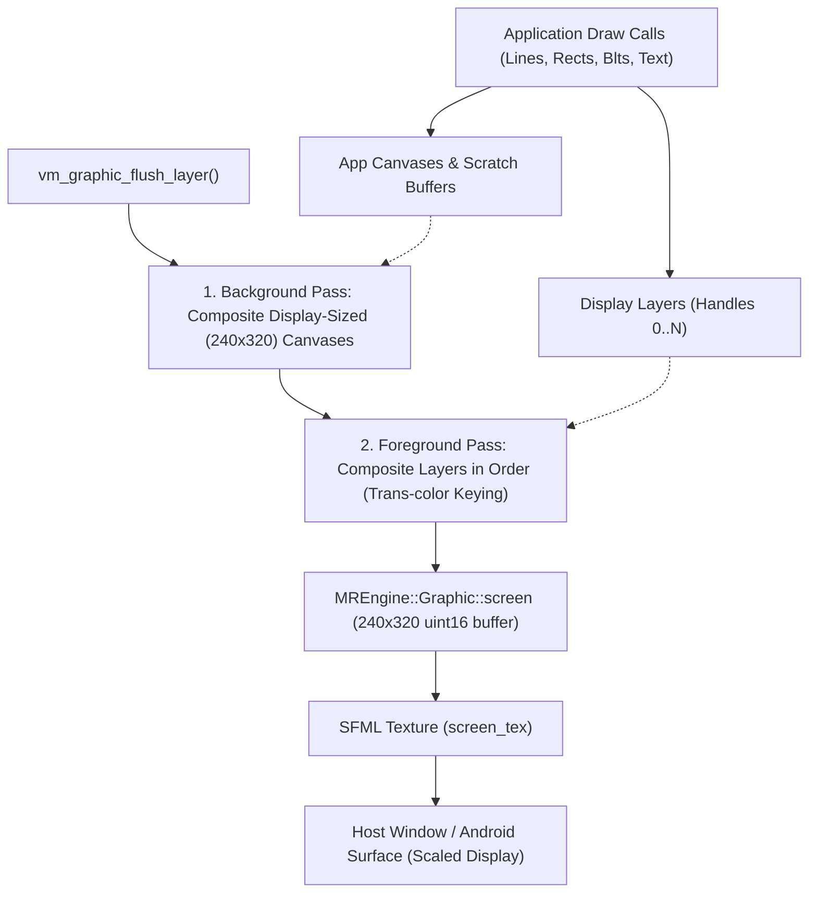

# Graphics Subsystem & Display Pipeline

This document describes the 2D graphics architecture, drawing pipeline, canvas system, and font rendering engine in **MREmu**.

---

## 1. Display Architecture & Color Formats

MREmu emulates a typical MediaTek feature phone QVGA portrait display with a native resolution of **240 × 320 pixels**.

### Color Formats

The primary emulated format is **16-bit RGB565**:

- Red: 5 bits (bits 11–15)
- Green: 6 bits (bits 5–10)
- Blue: 5 bits (bits 0–4)

Helper macros perform bidirectional conversion between 24-bit/32-bit RGB888 and 16-bit RGB565:

```c
#define VM_COLOR_888_TO_565(r, g, b) (((r >> 3) << 11) | ((g >> 2) << 5) | (b >> 3))
#define VM_COLOR_GET_RED(c)   (((c >> 11) & 0x1F) << 3)
#define VM_COLOR_GET_GREEN(c) (((c >> 5) & 0x3F) << 2)
#define VM_COLOR_GET_BLUE(c)  ((c & 0x1F) << 3)
```

### Presentation Pipeline



The presentation is throttled to **30 FPS** inside `vm_graphic_flush_layer` using host sleep to emulate the refresh rate of physical feature phone LCD controllers.

---

## 2. Canvases and Memory Signatures

A **Canvas** in MRE represents an off-screen or on-screen surface containing graphical pixel data.

### Canvas Header Layout

A canvas allocated via `vm_graphic_create_canvas` or `vm_graphic_create_canvas_cf` is preceded by metadata headers of size `VM_CANVAS_DATA_OFFSET`:

```text
+-----------------------------------------------------------+ 0x00
| canvas_signature (12 bytes)                               |
|   magic[9]            : "MTKCANVAS\0"                     |
|   frame_count         : uint8_t                           |
|   i_dont_know         : uint8_t (0xFF)                    |
|   color_format        : vm_graphic_color_famat (16/24/32) |
+-----------------------------------------------------------+ 0x0C
| canvas_frame_property (20 bytes)                          |
|   flag                : uint8_t (transparency enabled?)   |
|   left, top           : uint16_t                          |
|   width, height       : uint16_t                          |
|   delay               : uint16_t                          |
|   trans_color_index   : uint8_t                           |
|   trans_color         : uint32_t (chroma key)             |
|   offset              : uint32_t (byte size of pixels)    |
+-----------------------------------------------------------+ 0x20 (VM_CANVAS_DATA_OFFSET)
| Raw Pixel Data (width * height * bpp)                     |
+-----------------------------------------------------------+
```

### Canvas vs Layer Buffer Pointer Conventions

> [!IMPORTANT]
> **Pointer Conventions**:
>
> - A **Layer** (`vm_graphic_create_layer`) returns a pointer directly to its **pixel buffer**.
> - A **Canvas** (`vm_graphic_create_canvas`) returns a pointer to the **canvas base** (`cs`), whereas `vm_graphic_get_canvas_buffer` also returns the base.
>
> The [`find_canvas_signature()`](../MREmu/MREngine/Canvas.cpp) helper detects whether an incoming buffer pointer points to the base header or to the pixel data by inspecting the magic string `"MTKCANVAS"`. **Never** hand-roll `buf - VM_CANVAS_DATA_OFFSET`; always use `find_canvas_signature()`.

---

## 3. Compositing & Display Presentation

Presentation to the actual screen occurs **exclusively** during `vm_graphic_flush_layer`:

1. **Display-Sized Canvas Pass**: MREmu first composites any app-owned canvas that is **exactly 240 × 320 pixels** onto `graphic->screen`.
   - *Rationale*: Many VXP apps (e.g. Opera Mini) render their primary interface into a 240×320 canvas rather than directly into a layer, and then call `vm_graphic_flush_layer` to present.
   - *Scratch Buffer Filtering*: The exact 240×320 size check prevents scratch canvases (such as a 320×4 rule or 320×16 text row) from corrupting the display buffer.
2. **Layer Pass**: All active layer handles passed to `vm_graphic_flush_layer` are composited on top from back to front, respecting transparent chroma keys (`trans_color`) and layer offsets `(x, y)`.
3. **Texture Update**: The 16-bit RGB565 screen buffer is converted to 32-bit RGBA and uploaded to `graphic->screen_tex` for display by the frontend.

---

## 4. 2D Drawing Primitives

All drawing functions utilize the [`MREngine::RenderBox`](../MREmu/MREngine/Graphic.h) class to calculate bounding boxes and apply layered clipping:

```cpp
RenderBox b(x, y, x + width, y + height);
b.clip(*cfp_dst);                             // Clip to canvas frame
b.clip(get_current_app_graphic().clip);        // Clip to global cliprect
b.clip(get_current_app_graphic().clip_by_buf); // Clip to layer cliprect
```

### Supported Primitives

- **Pixels**: `vm_graphic_set_pixel`, `vm_graphic_get_pixel`.
- **Lines**: `vm_graphic_line` implements Bresenham's line algorithm.
- **Rectangles**: Wireframe (`vm_graphic_rect`) and solid filled (`vm_graphic_fill_rect`).
- **Rounded Rectangles**: `vm_graphic_fill_roundrect` draws filled rectangles with rounded corners.
- **Ellipses**: `vm_graphic_ellipse` (outline) and `vm_graphic_fill_ellipse` (solid) implemented via the midpoint ellipse algorithm.
- **Gradients**: `vm_graphic_fill_gradient_rect` supports multiple linear styles:
  - `VM_GDI_GP_HORZ` (horizontal gradient)
  - `VM_GDI_GP_VERT` (vertical gradient)
  - `VM_GDI_GP_DIA` / `VM_GDI_GP_DIA_INV` (diagonal gradients)
  - `VM_GDI_GP_FLIP` (mirror flipped vertical gradient)

---

## 5. Blitting & Alpha Blending

The [`MREngine/Blt.cpp`](../MREmu/MREngine/Blt.cpp) module provides high-performance pixel block transfers:

### Master Blt Engine (`master_blt`)

A templated blitter that handles format conversion, transparent color skipping, and clipping between arbitrary color depths (16-bit, 24-bit, 32-bit RGB/RGBA):

```cpp
template <bool HasGlobalAlpha, bool IsSrcPARGB>
ColorRGBA blend_rgba(ColorRGBA src, ColorRGBA dst, uint8_t global_alpha);
```

- **Transformations**: Supports arbitrary coordinate mapping lambdas for **90°, 180°, and 270° rotation** (`vm_graphic_rotate`) and **X/Y mirroring** (`vm_graphic_mirror`).
- **Alpha Blending**: `vm_graphic_blt_ex` supports per-pixel alpha combined with a global alpha modifier (`0`–`255`), handling both pre-multiplied alpha (`VM_GRAPHIC_COLOR_FORMAT_32_PARGB`) and straight RGBA.

---

## 6. Text & Font Engine (GNU Unifont)

MRE applications output text using `vm_graphic_textout` and `vm_graphic_textout_by_baseline`.

### Font Representation

MREmu embeds the **GNU Unifont** bitmap font (`unifont.h`):

- Provides 16×16 bitmap glyphs covering the full Unicode Basic Multilingual Plane (BMP).
- ASCII characters occupy 8×16 cells; full-width CJK characters occupy 16×16 cells.
- Bitmaps are rendered directly into 16-bit canvas buffers, clipping against active render boxes.

### Text Measurement

- `vm_graphic_get_string_width(VMWSTR str)`: Calculates pixel width by tallying half-width (8px) and full-width (16px) glyphs.
- `vm_graphic_get_character_height(void)`: Returns standard glyph height (16 pixels).

---

## 7. SystemTextBox

For full-screen or popup text input (e.g. entering URLs in web browsers or text in chat apps), MREmu implements [`MREngine::SystemTextBox`](../MREmu/MREngine/SystemTextBox.cpp):

- Emulates the platform text-entry dialog.
- Supports caret movement, backspace, character typing, selection, scrolling, and multiline text.
- Intercepts SFML keyboard and touch events when active, calling the application's callback on confirm or cancel.
