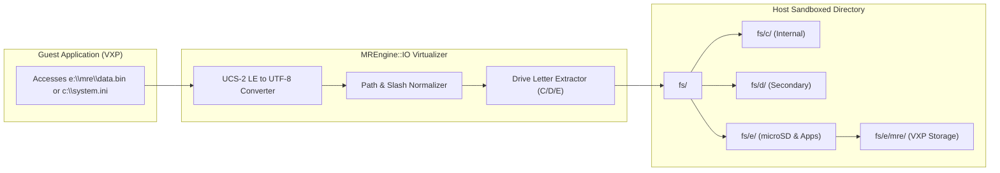

# File System & I/O Virtualization

This document details the virtualized file system, drive mapping, path translation, and I/O subsystems implemented in **MREmu**.

---

## 1. Virtual Drive Architecture

Feature phones running MediaTek MRE present storage to applications via traditional DOS/Windows-style drive letters:

| Emulated Drive | Purpose in Real Phones | Mapped Host Directory |
| :--- | :--- | :--- |
| `C:\` | Phone internal system storage (NOR/NAND flash). | `./fs/c/` (Desktop) or `/sdcard/MREmu/fs/c/` (Android) |
| `D:\` | Removable storage or secondary cache partition. | `./fs/d/` (Desktop) or `/sdcard/MREmu/fs/d/` (Android) |
| `E:\` | Primary external SD card partition (`E:\mre\`). | `./fs/e/` (Desktop) or `/sdcard/MREmu/fs/e/` (Android) |

On startup, [`MREngine::IO::init()`](../MREmu/MREngine/IO.cpp) guarantees that these directories exist on the host filesystem.

---

## 2. Path Translation & Encodings

MRE applications pass paths as **UCS-2 Little-Endian** wide strings (`VMWSTR`).

### The `path_from_emu` Pipeline

[`path_from_emu`](../MREmu/MREngine/IO.cpp) resolves virtual guest paths to sandboxed host filesystem paths:

1. **UCS-2 Decoding**: Converts 16-bit wide character strings into standard UTF-8 (`UCS2_to_path`).
2. **Slash Normalization**: Forward slashes (`/`) and backslashes (`\`) are normalized to match the host platform conventions (`std::filesystem::path::make_preferred`).
3. **Drive Routing**:
   - If the path begins with `c:`, it is redirected to `base_path / "fs/c"`.
   - If the path begins with `d:`, it is redirected to `base_path / "fs/d"`.
   - If no drive letter is specified or if it begins with `e:`, it routes to `base_path / "fs/e"`.
4. **Validation**: [`validate_path`](../MREmu/MREngine/IO.cpp) uses a regular expression to reject invalid filename characters (`*`, `?`, `"`, `<`, `>`, `|`) before invoking host filesystem APIs.

---

## 3. File Operations (`vm_file_*`)

The emulator translates MRE file operations to standard C runtime file streams (`FILE*`):

### File Handle Management

- File descriptors are stored in [`ItemsMng<FILE*>`](../MREmu/MREngine/ItemsMng.h).
- **Index 0 is explicitly reserved** (`NULL`) so that valid MRE file handles start at `1`, preventing apps that check `handle > 0` from failing.

### Core API Reference

| MRE Function | Native Mapping | Description |
| :--- | :--- | :--- |
| `vm_file_open` | `fopen` / `_wfopen` | Opens a file using MRE mode flags (`MODE_READ`, `MODE_WRITE`, `MODE_CREATE_ALWAYS_NO_OFFSET`, etc.). |
| `vm_file_close` | `fclose` | Closes an active file handle and frees its slot. |
| `vm_file_read` | `fread` | Reads up to `length` bytes into guest memory. |
| `vm_file_write` | `fwrite` | Writes bytes from guest memory to the host file. |
| `vm_file_seek` | `fseek` | Moves file pointer using `BASE_BEGIN`, `BASE_CURR`, or `BASE_END`. |
| `vm_file_tell` | `ftell` | Queries the current byte offset in the open file. |
| `vm_file_commit` | `fflush` | Flushes unwritten user space buffers to disk. |
| `vm_file_delete` | `std::filesystem::remove` | Deletes a file. |
| `vm_file_rename` | `std::filesystem::rename` | Renames or moves a file. |
| `vm_file_mkdir` | `std::filesystem::create_directory` | Creates a new directory. |
| `vm_file_rmdir` | `std::filesystem::remove` | Deletes an empty directory. |
| `vm_file_get_attributes` | `std::filesystem::status` | Returns file status flags (`VM_FS_ATTR_DIR`, etc.). |
| `vm_get_disk_free_space` | Query | Returns virtual free space (reports 16 MB or host disk space). |

---

## 4. Directory Enumeration (`vm_find_*`)

Applications enumerate files and folders (e.g. file managers, audio players, or the built-in launcher) using search handles:

### Search Element Structure (`find_el`)

Implemented in [`MREngine/IO.h`](../MREmu/MREngine/IO.h):

- Uses `std::filesystem::directory_iterator`.
- Implements wildcard matching by converting MRE wildcard patterns (e.g. `*.vxp`, `*.*`) into standard C++ regular expressions (`std::regex`).

### API Functions

- `vm_find_first_ext`: Opens a directory search handle and returns the first matching item.
- `vm_find_next_ext`: Advances the iterator and populates `vm_fileinfo_ext` with name, size, and timestamp.
- `vm_find_close_ext`: Closes the search handle and releases the iterator.

> [!WARNING]
> **Concurrent Enumerations**: As noted in [Known Issues](known_issues.md#a-second-concurrent-directory-enumeration-stops-after-one-entry), opening a second directory enumeration handle while another is active can cause the second enumeration to stop prematurely after one entry. Always ensure handles are closed when scanning completes.

---

## 5. Clear User Data & Reset

The desktop UI and Android settings include a **Clear User Data** action (`clear_user_data` in [`MREmu.cpp`](../MREmu/MREmu.cpp)):

- Scans `fs/c/`, `fs/d/`, and `fs/e/`.
- **Preserves** all `.vxp` packages so installed applications are not deleted.
- Deletes generated save files, caches, settings, and logs, returning the virtual environment to a clean state.
