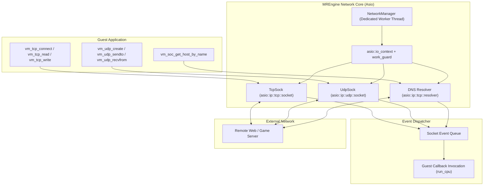

# Networking & Sockets

This document details the network virtualization architecture, asynchronous socket implementation, and DNS resolution subsystems in **MREmu**.

---

## 1. Network Subsystem Architecture

Many popular MRE applications (such as Opera Mini, mobile QQ, weather widgets, and online games) require internet connectivity. MREmu provides an asynchronous BSD-like socket layer built on top of **standalone Asio** (`asio::asio`):



The [`MREngine::NetworkManager`](../MREmu/MREngine/Sock.h) owns a dedicated worker thread running `asio::io_context::run()`. This ensures that network I/O, DNS queries, and packet buffering occur non-blockingly without stalling the CPU emulation thread.

---

## 2. TCP Sockets (`TcpSock`)

Implemented in [`MREngine/Sock.cpp`](../MREmu/MREngine/Sock.cpp), `TcpSock` encapsulates an asynchronous TCP stream.

### Connection & Lifecycle

1. **Creation & Connect**:

   ```c
   VMINT vm_tcp_connect(const char* host, const VMINT port, const VMINT apn, void (*callback)(VMINT handle, VMINT event));
   ```

   An asynchronous resolve and connect operation is dispatched via Asio.
2. **Events**: When state changes occur, the application callback is invoked with event codes:
   - `VM_TCP_EVT_CONNECTED` (`1`): Connection successfully established.
   - `VM_TCP_EVT_CAN_WRITE` (`2`): Output socket buffer is ready for sending.
   - `VM_TCP_EVT_CAN_READ` (`3`): Incoming data is available to read.
   - `VM_TCP_EVT_PIPE_BROKEN` (`4`): Connection reset or aborted.
   - `VM_TCP_EVT_HOST_NOT_FOUND` (`5`): DNS lookup failed.
   - `VM_TCP_EVT_PIPE_CLOSED` (`6`): Connection closed gracefully.
3. **Reading & Writing**:
   - `vm_tcp_read`: Reads available bytes from the socket into guest RAM.
   - `vm_tcp_write`: Sends bytes over the TCP socket.
4. **Teardown**:
   - `vm_tcp_close`: Shuts down the socket and releases the socket handle.

---

## 3. UDP Sockets (`UdpSock`)

Implemented in [`MREngine/Sock.cpp`](../MREmu/MREngine/Sock.cpp) for connectionless datagram communications.

### Datagram Operations

- `vm_udp_create`: Binds a local port (with support for loopback-only binding).
- `vm_udp_sendto`: Sends a datagram to a target host and port described by `vm_sockaddr_struct`.
- `vm_udp_recvfrom`: Reads an incoming datagram and records the remote sender's address.
- `vm_udp_close`: Closes the UDP socket.

### Addressing Structure (`vm_sockaddr_struct`)

```c
typedef struct {
    VMINT16  addr_len;                  // Address byte length
    VMUINT16 port;                      // Port number (host byte order)
    VMUINT8  addr[VM_MAX_SOCK_ADDR_LEN];// IP address bytes
} vm_sockaddr_struct;
```

---

## 4. DNS Host Resolution

Many applications perform explicit domain name resolution before connecting:

```c
VMINT vm_soc_get_host_by_name(
    VMINT apn,
    const VMCHAR* host,
    vm_soc_dns_result* result,
    VMINT(*callback)(vm_soc_dns_result*)
);
```

### Resolution Flow

1. MREmu checks if the host string is already a numeric IPv4 address (`a.b.c.d`). If so, it returns immediately with `VM_E_SOC_SUCCESS`.
2. Otherwise, an asynchronous resolve query is initiated via `asio::ip::tcp::resolver`.
3. Up to 5 resolved IPv4 addresses are written into `result->address[0..4]` (`VM_SOC_DNS_MAX_ADDR`).
4. The application callback is triggered with the populated `vm_soc_dns_result` structure.

---

## 5. Connectivity Checks & Stubs

Applications often query the network environment to determine whether to prompt the user about data costs:

- `vm_is_support_wifi()`: Returns `1` (indicating Wi-Fi is supported).
- `vm_wifi_is_connected()`: Returns `1` (indicating active high-speed connection).
- Access Point Name (APN) accounts (`apn`) are accepted and abstracted away, allowing traffic to route directly through the host network interface.
